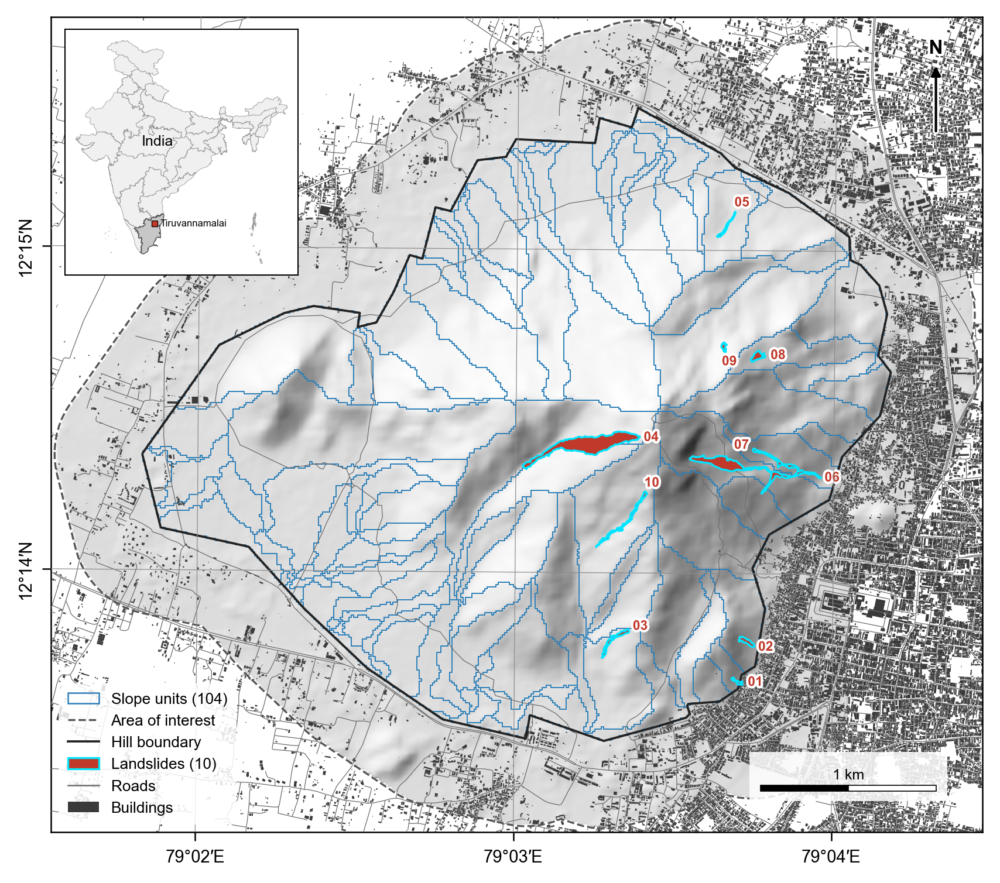
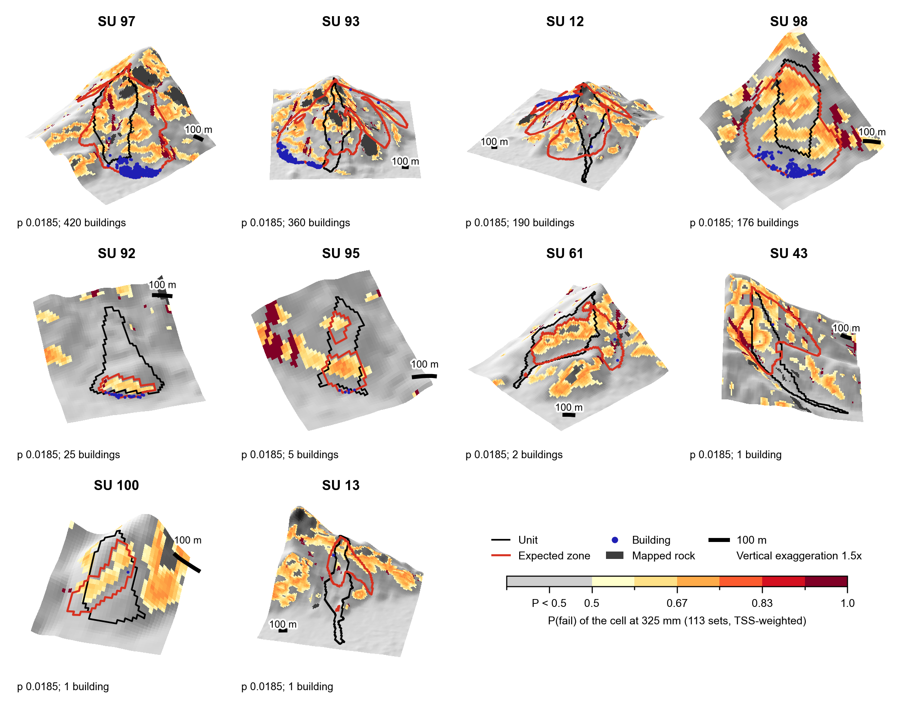

> **⚠️ Work in progress.** This repository is under active preparation alongside an unpublished manuscript. Results shown here are preliminary and have not been peer reviewed.
>
> ## Study area
> 
 
*Study area. The hill is divided into 104 slope units (blue outlines), with the 10 inventoried landslides (01 to 10) shown in red. Dense settlement and buildings (dark grey) lie directly against the eastern and southern foot of the hill. Inset: location in India.*

## Slope-unit forecast
 

 
*3D views of the ten slope units with the highest building exposure. Cell colour is the probability of failure at 325 mm of rainfall, from a 113-set TRIGRS parameter ensemble weighted by TSS. The black line is the slope unit, the red line the expected failure zone, and blue dots are buildings (counts under each panel). Vertical exaggeration is 1.5x.*

## License
 
See [LICENSE](LICENSE).
